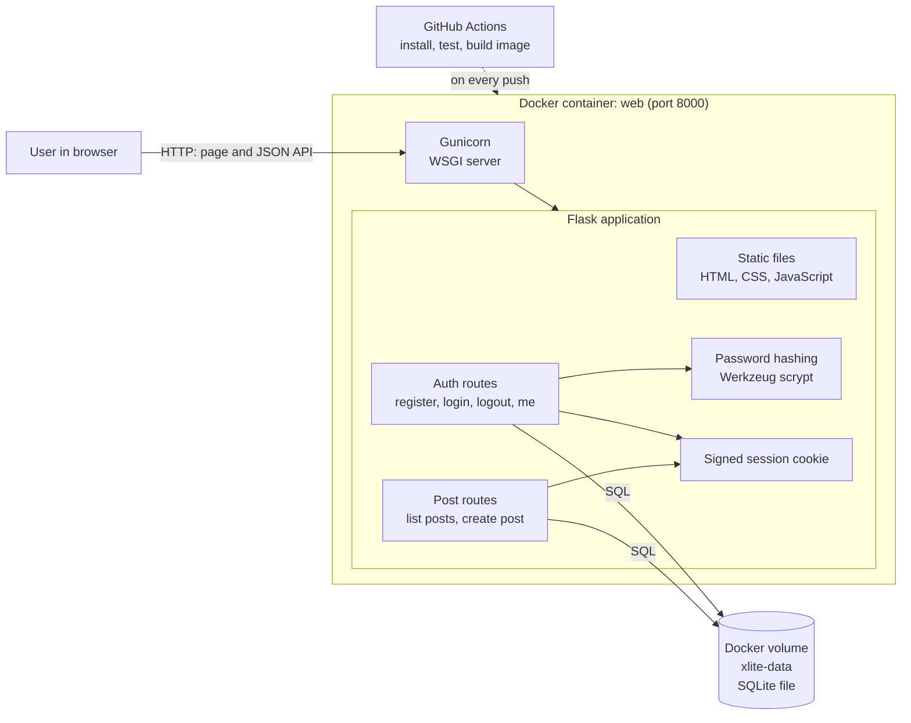

# Part D: Architecture and Technology Decisions

## Overview

X Lite is a **monolith**. One Flask application serves the web page and the JSON API. It stores data in a SQLite file kept on a Docker volume. The whole system runs as one container.

## Architecture diagram



## Data model

```
users                              posts
-----                              -----
id            INTEGER PK           id          INTEGER PK
username      TEXT UNIQUE (nocase) user_id     INTEGER FK -> users.id
password_hash TEXT                 content     TEXT (1 to 280 chars, checked in code)
created_at    TEXT (UTC ISO)       created_at  TEXT (UTC ISO)
```

An index on `posts(created_at DESC, id DESC)` keeps the feed query fast.

## API

| Method | Path | Auth | Purpose |
|--------|------|------|---------|
| POST | /api/register | No | Create account and sign in |
| POST | /api/login | No | Sign in |
| POST | /api/logout | No | Sign out |
| GET | /api/me | Yes | Current user |
| GET | /api/posts | No | Feed, newest first |
| POST | /api/posts | Yes | Create a post |
| GET | /api/health | No | Health check for Docker and CI |

## Technology choices

| Layer | Choice | Reason |
|-------|--------|--------|
| Frontend | Plain HTML, CSS and JavaScript | The UI has one page and two forms. A build step and a framework would add work and risk without value. |
| Backend | Python 3.12 with Flask | Small, well known, quick to test with pytest. |
| Server | Gunicorn | A real WSGI server, better than Flask's development server inside a container. |
| Database | SQLite on a Docker volume | No extra container, zero setup, data survives restarts. Enough for demo load. |
| Authentication | Server-side checks with a signed session cookie | Simple and safe for a single web app. HttpOnly and SameSite=Lax limit cookie theft and cross-site requests. |
| Password hashing | Werkzeug `generate_password_hash` (scrypt, salted) | Industry standard slow hash, already part of Flask. |
| Tests | pytest with Flask's test client | Fast tests with a temporary database per test. |
| Container | Docker and Compose | One command to run, as the brief requires. |
| CI | GitHub Actions | Free, close to the repository. |

## ADR-001: Monolith with SQLite and server-rendered session auth

**Status:** Accepted

**Context.**
The customer wants an MVP for an investor demo in a few weeks. It must run locally with Docker and be easy for a lecturer to start. The team has one or two people. Load will be tiny.

**Decision.**
Build one deployable unit: a Flask monolith that serves static files and a JSON API, with SQLite for storage and cookie sessions for login.

**Alternatives considered.**

| Alternative | Why it was not chosen |
|-------------|-----------------------|
| Microservices (auth, posts and gateway as separate services) | Three to four containers, network calls, and shared contracts for a product with two tables. The overhead would eat the time budget. |
| React or Vue single page app with its own container | Adds Node tooling, a build step and a second container. The UI is too small to justify it. |
| PostgreSQL in a second container | Better for many writers and for production, but adds setup and startup ordering. SQLite is enough here. |
| JWT tokens in local storage | More moving parts (expiry, refresh) and tokens in JavaScript are exposed to XSS. Cookie sessions are simpler and safer for this case. |

**Consequences and trade-offs.**
- (+) One command starts everything. Fewer things can break during the demo.
- (+) Simple to test and to explain.
- (+) Fast to build, so more time goes to quality and documentation.
- (-) SQLite allows only one writer at a time. This is fine for a demo but would limit a busy product.
- (-) Scaling means moving to several app instances, and SQLite on a local volume does not allow that. The first step would be to switch to PostgreSQL.
- (-) Sessions are signed cookies with a shared `SECRET_KEY`. Several instances would need the same key, and a leaked key lets an attacker forge sessions. The key must be kept secret and changed for any real deployment.
- (-) A plain JavaScript frontend has no component model. It would get hard to maintain if the UI grew a lot.

**Upgrade path.** Replace SQLite with PostgreSQL behind the same SQL queries, add a reverse proxy with HTTPS, and split the frontend into its own app if the UI grows.

## ADR-002: Store timestamps in UTC as ISO 8601 text

**Status:** Accepted

**Context.** Posts must show a creation date and sort newest first. Users may be in different time zones.

**Decision.** Store UTC timestamps as ISO 8601 strings with microseconds (`2026-10-17T16:20:05.123456Z`). The browser converts them to local time for display.

**Alternatives.** Unix integers (harder to read in the database), local server time (breaks when the server or user moves).

**Trade-offs.** ISO strings in this fixed format sort correctly as text, which keeps the query simple. The id is used as a tie breaker for posts created in the same microsecond.

## ADR-003: Show post text with `textContent`

**Status:** Accepted

**Context.** Posts come from other users, so they cannot be trusted.

**Decision.** Store text exactly as typed and render it with `textContent`. Never use `innerHTML` for user content.

**Alternatives.** Strip or escape HTML when saving (hides the original and can double-escape).

**Trade-offs.** Output encoding at display time is the safer rule, because it protects every place the text is shown. The cost is that any future client must also render text safely.

## Security notes

- Passwords: salted scrypt hashes only.
- SQL injection: all queries use bound parameters.
- XSS: user text rendered with `textContent`.
- Session cookie: HttpOnly, SameSite=Lax. Set `SESSION_COOKIE_SECURE` and serve over HTTPS in a real deployment.
- The container runs as a non-root user.
- Secrets come from environment variables. `.env` is in `.gitignore`.
- Known gaps, accepted for the MVP: no rate limiting on login, no CSRF token (SameSite=Lax and JSON-only endpoints reduce the risk).
